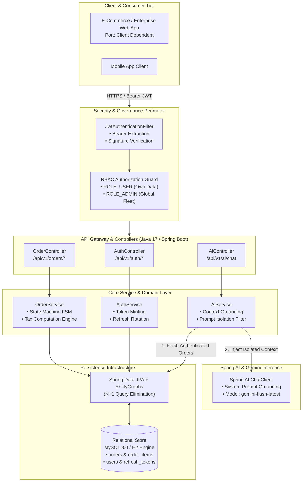

# Order Lifecycle & Fulfillment Engine

[](https://adoptium.net)
[](https://spring.io)
[](https://spring.io/projects/spring-ai)
[](https://deepmind.google/technologies/gemini/)
[](https://www.mysql.com)
[](https://hibernate.org)
[](https://mapstruct.org)
[](https://swagger.io)
[](https://jwt.io)
[](LICENSE)

An enterprise-grade **order processing service and intelligent customer resolution platform** combining an audited finite state machine with **grounded conversational AI**. Built on **Java 17**, **Spring Boot 3.4.1**, **Spring AI**, and **Google Gemini Flash**, the system orchestrates resilient order lifecycle transitions (`CREATED` $\to$ `PROCESSING` $\to$ `COMPLETED` / `CANCELLED`), prevents N+1 query bottlenecks via JPA EntityGraphs, and enforces strict zero-data-leakage prompt grounding to resolve customer inquiries securely.

---

## Key Architecture Pillars

- **Audited Order Finite State Machine (`io.github.vikij.ordermanagement.order`):**
  Deterministic lifecycle enforcement guaranteeing orders progress strictly along validated pathways (`CREATED` $\to$ `PROCESSING` $\to$ `COMPLETED`/`CANCELLED`) with domain invariant validation and automated tax adjustments.
- **Dynamic Prompt Grounding & Context Isolation (`io.github.vikij.ordermanagement.ai`):**
  Secure context injection feeding only authenticated customer order history into Google Gemini Flash `ChatClient`, eliminating cross-tenant data leaks and hallucinated resolution terms.
- **High-Performance JPA EntityGraphs (`io.github.vikij.ordermanagement.order`):**
  Optimized relational persistence utilizing Spring Data JPA NamedEntityGraphs to fetch order headers and associated line items in a single round-trip, completely eradicating N+1 query degradation.
- **Stateless JWT Security & Token Rotation (`io.github.vikij.ordermanagement.auth`):**
  Dual-token architecture issuing short-lived access JWTs and database-persisted refresh tokens, paired with granular RBAC guards (`ADMIN`, `USER`).
- **Declarative DTO Mapping with MapStruct (`io.github.vikij.ordermanagement.common`):**
  Compile-time type-safe object transformations preventing runtime reflection penalties and maintaining absolute separation between internal JPA entities and public REST contracts.

---

## System Architecture



---

## Order State Machine & Grounding Invariants

The platform maintains strict integrity across order status progressions and AI reasoning boundaries:

$$\text{TotalAmount} = \sum_{i=1}^{n} (\text{UnitPrice}_i \times \text{Quantity}_i) \times (1 + \text{TaxRate})$$

$$\text{Context}_{\text{LLM}} = \{ O_k \in \text{Orders} \mid O_k.\text{userId} = \text{Principal}.\text{id} \}$$

| Initial State | Allowed Target State | Trigger Condition | Authorization Required |
| :--- | :--- | :--- | :---: |
| **`CREATED`** | `PROCESSING` | Payment confirmed & inventory reserved | `ROLE_ADMIN` |
| **`CREATED`** | `CANCELLED` | Customer cancellation before fulfillment | `ROLE_USER` / `ROLE_ADMIN` |
| **`PROCESSING`**| `COMPLETED` | Carrier delivery confirmation | `ROLE_ADMIN` |
| **`PROCESSING`**| `CANCELLED` | Inventory deficit / fulfillment failure | `ROLE_ADMIN` |
| **`COMPLETED`** | *Terminal* | Immutable record; archive state | None |
| **`CANCELLED`** | *Terminal* | Immutable record; refund issued | None |

---

## Quickstart & Platform Orchestration

### Prerequisites
- Java 17 LTS & Maven 3.9+
- Google AI Studio API Key ([Get API Key](https://aistudio.google.com/apikey))
- MySQL 8.0 (Optional; H2 in-memory database used by default for local development)

---

### Option A: Local Development Launch with H2 (Recommended)

Run the entire platform with embedded H2 persistence and live Swagger documentation:
```bash
# Clone repository
git clone https://github.com/i-viki/order-management-service.git
cd order-management-service

# Create local environment config
cp .env.example .env
# Edit .env and insert your GEMINI_API_KEY

# Launch application via Maven wrapper
./mvnw spring-boot:run
```
*Application boots on `http://localhost:8080` with in-memory H2 database active.*

---

### Option B: Production MySQL Launch

#### Step 1: Start MySQL Datastore
```bash
docker run --name order-mysql -e MYSQL_ROOT_PASSWORD=root -e MYSQL_DATABASE=order_management -p 3306:3306 -d mysql:8.0
```

#### Step 2: Configure Environment Profile
Set `SPRING_PROFILES_ACTIVE=prod` in `.env` and configure MySQL credentials:
```properties
SPRING_PROFILES_ACTIVE=prod
DB_URL=jdbc:mysql://localhost:3306/order_management
DB_USERNAME=root
DB_PASSWORD=root
GEMINI_API_KEY=your_gemini_api_key_here
JWT_SECRET=your_super_secret_jwt_key_at_least_32_characters_long
```

#### Step 3: Boot Application
```bash
./mvnw spring-boot:run
```

---

## Decoupled Environment Strategy

All services extract hostnames, ports, and external LLM keys into environment files loaded via `dotenv-java`:

| Service / Layer | Config File | Template Reference | Key Variables |
| :--- | :--- | :--- | :--- |
| **Application Core** | `src/main/resources/application.properties` | [`.env.example`](.env.example) | `SPRING_PROFILES_ACTIVE`, `SERVER_PORT` |
| **AI Substrate** | `application.properties` | [`.env.example`](.env.example) | `GEMINI_API_KEY`, `SPRING_AI_GEMINI_CHAT_MODEL` |
| **Persistence Layer**| `application.properties` | [`.env.example`](.env.example) | `DB_URL`, `DB_USERNAME`, `DB_PASSWORD`, `HIBERNATE_DIALECT` |
| **Security Layer** | `application.properties` | [`.env.example`](.env.example) | `JWT_SECRET`, `JWT_EXPIRATION_MS`, `JWT_REFRESH_EXPIRATION_MS` |

---

## Live Telemetry & Observability Hubs

| Hub / Service | Port | URL | Role & Live Features |
| :--- | :--- | :--- | :--- |
| **Interactive Swagger UI** | `8080` | [http://localhost:8080/swagger-ui.html](http://localhost:8080/swagger-ui.html) | OpenAPI 3.0 interactive API documentation and execution sandbox. |
| **OpenAPI Schema** | `8080` | [http://localhost:8080/v3/api-docs](http://localhost:8080/v3/api-docs) | Raw JSON OpenAPI 3 specification for client SDK generation. |
| **H2 Database Console** | `8080` | [http://localhost:8080/h2-console](http://localhost:8080/h2-console) | In-memory relational inspection console (`jdbc:h2:mem:orderdb`). |
| **Actuator Health** | `8080` | [http://localhost:8080/actuator/health](http://localhost:8080/actuator/health) | Application health checks, datasource validation, and JVM metrics. |

---

## Testing & Quality Assurance Suite

### Unit & Integration Test Suites
```bash
./mvnw test
# Validates order lifecycle state transitions, MapStruct bindings, and security filters.
```

### AI Support Query with Grounded Orders
```bash
curl -X POST http://localhost:8080/api/v1/ai/chat \
  -H "Content-Type: application/json" \
  -H "Authorization: Bearer <JWT_TOKEN>" \
  -d '{
    "message": "Where is my latest order and what items are included?"
  }'
```

### Order Creation Sample Request
```bash
curl -X POST http://localhost:8080/api/v1/orders \
  -H "Content-Type: application/json" \
  -H "Authorization: Bearer <JWT_TOKEN>" \
  -d '{
    "items": [
      { "productName": "Ergonomic Mechanical Keyboard", "quantity": 1, "unitPrice": 149.99 },
      { "productName": "USB-C Braided Cable", "quantity": 2, "unitPrice": 19.99 }
    ]
  }'
```

---

## Author

**Jayavignesh**
- **Website:** [jayavignesh.dev](https://jayavignesh.dev)
- **GitHub:** [@i-viki](https://github.com/i-viki)
- **Email:** [hello@jayavignesh.dev](mailto:hello@jayavignesh.dev)

---

## License

This platform is distributed under the **MIT License**. See the [`LICENSE`](LICENSE) file for complete terms.
